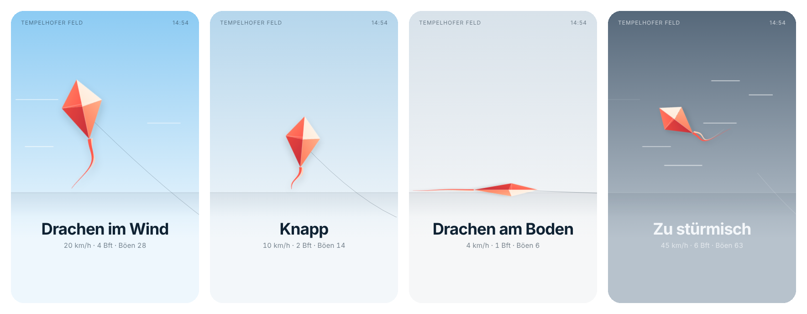

# 🪁 Drachenwetter

Fliegt der Drachen heute auf dem Tempelhofer Feld?

**→ [grobie.github.io/drachenwetter](https://grobie.github.io/drachenwetter/)**

- **Auf einen Blick:** Drachen im Wind, knapp, am Boden oder zu stürmisch. Antippen zeigt Messwerte und Vorhersage, oben links lässt sich der Ort wechseln.
- **Am Wochenende:** Hinweis per [ntfy](https://ntfy.sh), wenn tagsüber Drachenwind kommt (Freitagabend als Vorschau, Samstag/Sonntag morgens).
- **Daten:** Deutscher Wetterdienst – Messung der Station Berlin-Tempelhof über [Bright Sky](https://brightsky.dev), Vorhersage (ICON) über [Open-Meteo](https://open-meteo.com).

| | Mittelwind |
|---|---|
| Drachen im Wind | 12–38 km/h |
| Knapp | 8–12 km/h |
| Am Boden | unter 8 km/h |
| Zu stürmisch | über 38 km/h oder Böen über 55 km/h |

Installieren: Seite in Chrome öffnen → **⋮ → App installieren**.
Benachrichtigungen: ntfy-App installieren und das Thema aus dem Secret `NTFY_TOPIC` abonnieren.
